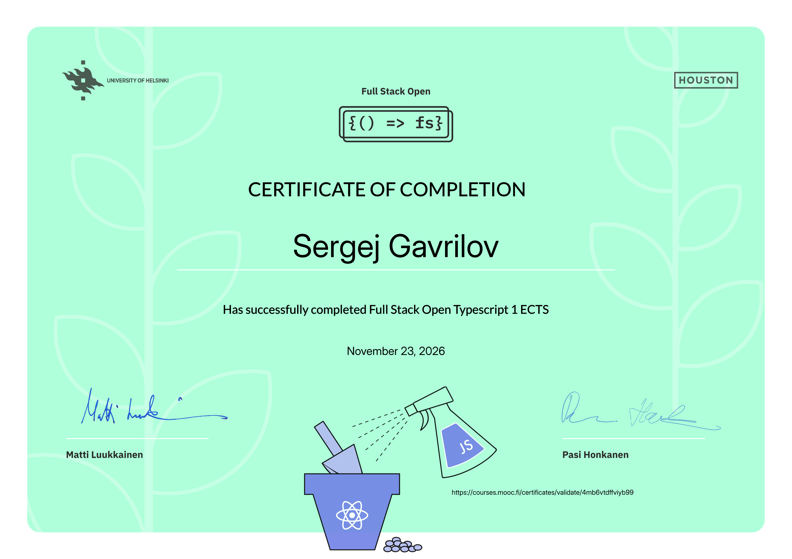

# Full Stack Open — Part 9

Solutions for [Full Stack Open, part 9: TypeScript](https://fullstackopen.com/en/part9).

Parts 0–5: [fullstack-open-part00-05](https://github.com/Kopfdreher/fullstack-open-part00-05).

[TypeScript](https://www.typescriptlang.org/) checks data shapes before the program runs. Incoming values stay `unknown` until parsed. Flight diaries use [Zod](https://zod.dev/).

| Directory | What it covers |
| --- | --- |
| `healthapp` | BMI and exercise calculators, then an Express API |
| `healthapp-tests` | Playwright tests for `/hello`, `/bmi`, and `/exercises` |
| `patientor/frontend` | Typed React UI for patients |
| `patientor/backend` | Patientor API |
| `patientor-tests` | Playwright tests for the Patientor UI |
| `patientor-api-tests` | Playwright tests for the Patientor API |
| `flightdiaries/backend` | Flight diary API with Zod and non-sensitive responses |

From each app directory: `npm install` and `npm run dev`. Tests: `npm test` from the test directory, with the matching server already running.

## Certificate

